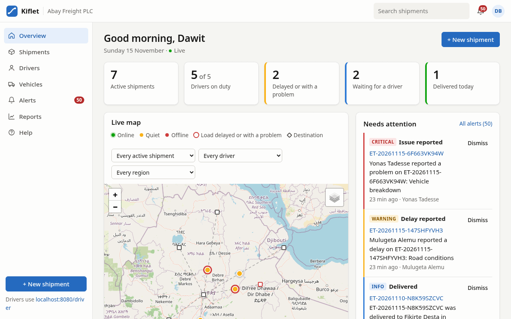
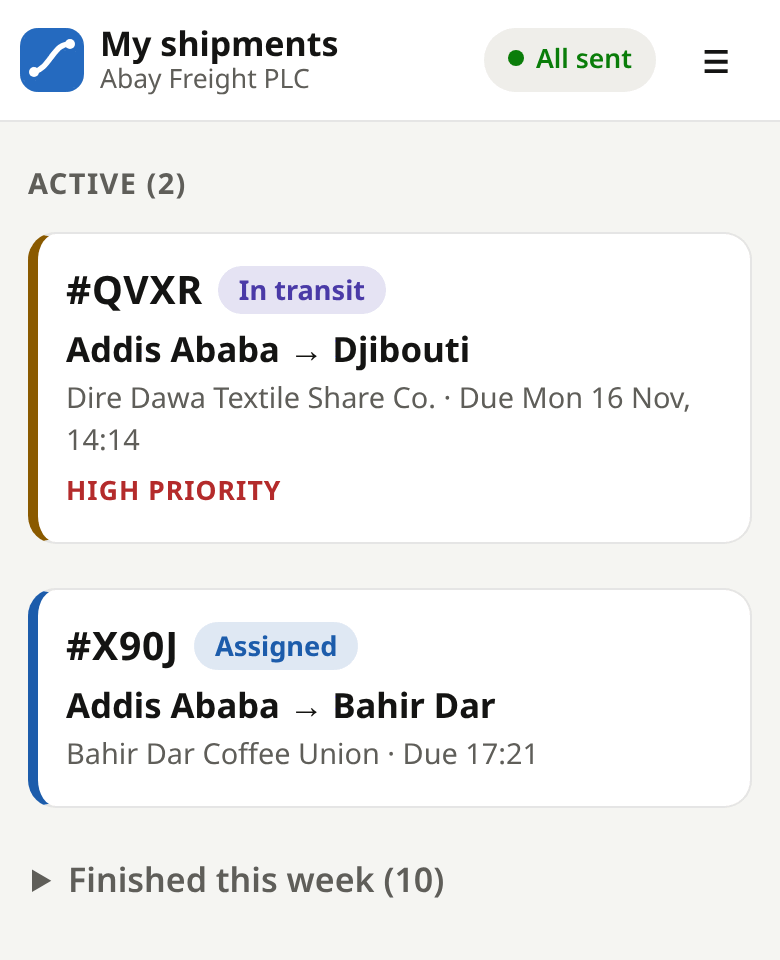

# Kiflet

**Shipment tracking and proof of delivery for Ethiopian trucking companies.**
A *kiflet* (ቅፍለት) is a caravan.

| The dispatcher's overview | The driver app |
|---|---|
|  |  |

A dispatcher books a load and assigns a driver. The driver's phone keeps
working with no signal: status changes, signatures, photos and GPS positions
(taken while the app is open) are saved on the phone and sent when a network
returns. The customer gets an SMS with a
tracking link when the load leaves, is delayed, arrives and is delivered, then
confirms receipt with one tap. Each delivery is recorded with the recipient's
name, their signature, up to three photos and where the phone was. A delivery
recorded far from the destination is flagged.

It is built for the road between Addis Ababa and Djibouti, not for a city with
perfect coverage. Drivers with feature phones report by SMS instead
(`ET 7K3M 3` means "arrived").

## What's in it

| For | Where | What they get |
|---|---|---|
| Dispatchers, fleet managers, admins | `/app` | A live fleet map (positions come while the driver app is open) with filters, route lines and a satellite view; a shipment board that updates as drivers report, with tabs, filters, saved views, sortable columns and bulk assignment; booking with a town list or a dropped pin; status overrides; messages to one driver or to every driver on the road; alerts (late, not collected, problem reported, driver quiet with cargo, moving away from the destination, delivered) with optional browser notifications and email copies; each trip's GPS history; reports by period, driver and route, with CSV and PDF; printable waybills; team and vehicle management; an audit log; company settings and SMS preferences; a download of all the company's data; questions to the Kiflet team on the Help page |
| Drivers | `/driver/` | An installable, offline-first web app in English or Amharic: today's loads, one-tap status updates, delay and problem reports with reasons, messages to the office, delivery capture (name, signature, photos, GPS) with a warning away from the drop-off, distance and direction to the drop-off, battery saver, settings that follow the driver to a new phone, and a sync indicator that shows what is still waiting to send and when the signal is weak |
| Drivers on feature phones | SMS | `ET <last 4> <code> [note]`, codes 1 departed, 2 delayed, 3 arrived, 4 delivered, 5 problem |
| Customers | `/track`, SMS links | Tracking by number or by phone (one-time SMS code), a coarse last-known position, and a confirm-or-report-a-problem page after delivery |
| Company admins | `/app/billing` | The plan and this month's usage, plan changes, printable invoices, payment by telebirr or CBE Birr, or bank transfer details |
| The operator | `/app/platform` | Every company with its plan and activity, trial extensions, Enterprise terms, suspension and deletion; unpaid invoices, bank transfers to record, refunds to send, monthly recurring revenue; the companies' questions; every company's audit log; system health (database, background jobs, message queues, disk) |

Companies sign up on their own, confirming the admin's phone with an SMS code,
and either start a 14-day free trial or choose a plan and pay at once. Staff
who forget their password reset it with an emailed link.
Data is separated per company throughout, and there are five roles: driver,
dispatcher, fleet manager, admin and platform admin.

## Plans

| Plan | Drivers | Texts a month | Price |
|---|---|---|---|
| Free trial | 10 | 500 | free for 14 days |
| Starter | 10 | 500 | ETB 2,500 a month |
| Business | 50 | 3,000 | ETB 9,000 a month |
| Enterprise | agreed | agreed | agreed with the operator |

Every plan has the whole product, with unlimited office staff and shipments;
plans differ only in limits. Prices exclude 15% VAT, and a year costs ten
months. Texts beyond the allowance are never blocked, because a customer who
misses a delivery update costs more than the text: each costs ETB 0.50 on the
next month's usage invoice.

A company pays for each period in advance, by bank transfer, which the
operator records, or by mobile money. There is no real telebirr or CBE Birr
adapter yet: `pkg/payments` has the interface and the stand-ins, so a
production site takes bank transfers until one is written.

An upgrade applies once its prorated invoice is paid. A smaller plan, or the
other billing cycle, starts with the next period. A plan change waits while a
renewal or usage invoice is unpaid. Invoices are due 7 days after they are
issued.

A company becomes **read-only** when its trial ends, or when a renewal or
usage invoice is still unpaid 7 days after it was due. Read-only stops new
work only: booking shipments, assigning unassigned ones, and adding drivers,
vehicles or staff. Loads already on the road carry on, with driver updates,
proof of delivery, reassignment and customer SMS. Viewing, exporting and
paying always work, and paying lifts it at once. The operator can also
suspend a company, which signs everyone out.

Money that arrives for an invoice already paid or cancelled is not kept: the
operator sees it under **Refunds to send** and records the refund once it is
sent back.

### Data

- **Export.** A company admin downloads everything as one ZIP from
  Settings: CSV files of shipments, their history, deliveries, people and
  vehicles, with each delivery's signature and photos.
- **Removing a person.** Once a driver or staff member is deactivated, an
  admin can remove their details: the name becomes "Former driver" and the
  phone, email and sign-in are erased, while their history stays.
- **Retention.** Customer details, delivery photos and signatures are removed
  from shipments that finished more than `RETAIN_SHIPMENT_DAYS` ago (365 by
  default); the dates, route, driver and cargo stay for reports. GPS points
  are kept 90 days, alerts 90 days, and texts and emails 180 days.
- **Audit.** The audit log and shipment histories are append-only: a database
  trigger rejects changes and deletions. Deleting a company, which only the
  operator can do, is the exception: its data and media go, its invoices stay,
  and one entry in the platform's own log records it.

## Architecture

One Go binary serves everything:

```
          browsers (dashboard, tracking)        driver phones (PWA)        SMS provider
                      │  HTML + WebSocket              │  JSON sync              │  webhook
                      └───────────────┬────────────────┴─────────────┬──────────┘
                                ┌─────▼──────────────────────────────▼───────┐
                                │  kiflet (cmd/server)                       │
                                │  internal/web      routes, templates, API  │
                                │  internal/service  business rules          │
                                │  jobs: outboxes, alerts, billing, cleanup  │
                                └─────────────────────┬──────────────────────┘
                                              PostgreSQL + PostGIS
```

- **Server-rendered dashboard.** `html/template` with a little vanilla JS for
  live updates, maps (Leaflet, vendored) and charts (inline SVG). No build step,
  and a strict CSP (`script-src 'self'`). When the WebSocket reports a change,
  a page fetches itself again and swaps in its live parts, so the server
  renders everything.
- **Driver app as a PWA** (`internal/web/static/driver`). A service worker
  caches the shell, IndexedDB holds shipments and an outbox, and `POST
  /api/v1/driver/sync` exchanges everything in one gzip-compressed request.
  Every change carries a client ID, so a resend after a lost response is
  harmless. When the phone and the office disagree, the office wins and the
  driver is told why. The app asks the browser to keep its data
  (`navigator.storage.persist()`), so unsent deliveries survive a full
  phone.
- **SMS and email go through outboxes** in the database, sent by a background
  worker with retries, so a provider outage delays a message rather than
  losing it. Customers can text STOP to opt out.
- **Outside services have stand-ins.** SMS, email and payments default to
  providers that print what they would send in the server's terminal: codes,
  links and invoices, and to pages of the server that play telebirr's
  checkout and CBE Birr. A production deployment refuses to start with them
  unless `ALLOW_MOCK_PROVIDERS=true`.
- **A provider sandbox** (`cmd/sandbox`) plays Ethio telecom's SMS gateway,
  telebirr and CBE Birr as a separate service, so the real adapters can be
  run against something that answers like the providers, faults included.
- **Everything is embedded**: templates, static files and migrations are in the
  binary, which migrates the database on start.

Tradeoff: a web app records GPS only while it is open on screen. When the
phone locks or the driver switches apps, positions stop until the app is
opened again, so the map shows where the truck last was, and the "driver
quiet" and "moving away from the destination" alerts work from what the app
sent. The app can keep the screen on while charging for long drives. Status
changes, proof of delivery and SMS reporting don't depend on GPS. Tracking
with the screen off needs a native wrapper with background location.

### Code map

```
backend/
  cmd/server/          main: serve, migrate, seed
  cmd/sandbox/         the provider sandbox: serve, keys
  internal/app/        builds the app from its settings: providers, services, web, workers
  internal/web/        HTTP: routes, middleware, handlers, templates/, static/
  internal/service/    shipments, status rules, sync, auth, SMS, email, billing, alerts, reports, jobs
  internal/model/      statuses, transitions, reasons, roles, plans and prices
  internal/db/         sqlc-generated queries (from sqlc/queries)
  internal/geo/        Ethiopian towns, distances, transit-time estimates
  internal/phone/      Ethiopian phone number normalisation
  internal/sandbox/    the providers' side of the SMS, telebirr and CBE Birr contracts, with
                       phones, wallets and faults (standard library only)
  migrations/          goose migrations, embedded
  pkg/                 SMS, email and payment providers, terminal stand-ins, storage (local or S3),
                       websocket hub, hashing
  tests/integration/   end-to-end tests over HTTP against PostGIS
  tests/e2e/           tests against staging, through Caddy over HTTPS
  deployments/         production compose file, Caddy, Prometheus, Grafana; staging/
  scripts/             backup and restore
```

## Run it locally

You need Go 1.26+ and Docker.

```bash
make db      # PostGIS on localhost:5434 (DB_PORT=… to change)
make seed    # migrate and load a demo company
make run     # http://localhost:8080
```

The demo company, Abay Freight PLC, has six weeks of delivered loads, a few
trucks on the road and two alerts:

| Sign in as | At | With |
|---|---|---|
| Administrator | `/login` | `demo@kiflet.et` / `kiflet-demo` |
| Dispatcher | `/login` | `dispatch@kiflet.et` / `kiflet-demo` |
| Platform admin | `/login` | `admin@kiflet.et` / `kiflet-admin` |
| Driver | `/driver/` | `0912345601` … `0912345605`, PIN `2580` |

SMS, email and payments are simulated by default: codes, links and payment
prompts are printed in the terminal running `make run`. To try a
feature-phone driver, open Settings → Text messages and send
`ET <last 4 of a tracking number> 3` from a driver's number, or run
`go run ./cmd/server sms-in 0912345601 "ET 7K3M 3"` from `backend/`.

`make dev` rebuilds on Go changes (with [air](https://github.com/air-verse/air)).
Templates and static files are reloaded from disk on every request either way.

### The provider sandbox

The stand-ins live inside the app. The provider sandbox is a separate
service that plays Ethio telecom's SMS gateway, telebirr and CBE Birr over
HTTP, so the app runs its real adapters: tokens, signatures, callbacks,
retries and lost notifications happen as they would with the providers. It
plays the people too: phones that receive texts and reply, wallets with a
balance, and payers who pay or cancel. No text reaches a phone and no money
moves.

```bash
make sandbox       # terminal 1: the sandbox on http://localhost:8091
make run-sandbox   # terminal 2: the app on :8080, its providers pointed at the sandbox
```

Give both the same `PORT` to move the app. They read `backend/sandbox.env`,
so they agree on keys and logins, and the first run writes throwaway telebirr
key pairs to `backend/sandbox-keys/`. Email is still printed in the app's
terminal. Then:

- Sign up, and read the code on the sandbox's phone page (`/phones/09…`).
- Book a shipment for a driver, open the driver's phone and reply
  `ET <ref> 1`.
- **Pay with telebirr** on an invoice: the app sends you to telebirr's
  checkout on the sandbox (any number, PIN `1234`), which brings you back.
  Pay another invoice by reference from its **Pay from a sandbox phone** link.
- On **Faults**, make the gateway go down or slow, bar numbers or put them
  out of reach, and drop, repeat, delay or forge notifications and
  confirmations. Calls a fault held back wait on the home page to be sent.
- **Log** shows every call in both directions with its headers and bodies,
  secrets masked.

`docker compose --profile sandbox up sandbox` runs the sandbox in a container
instead, for an app on the host. Tests and scripts drive it through a JSON
API (faults, phones, texts, payments, held calls and the log; see
`internal/sandbox/api.go`).

The sandbox shares no code with the app: each side implements the contracts
on its own, so a mistake on either side shows up as a refused call rather
than two copies agreeing.

### Tests

```bash
make test               # unit tests
make test-integration   # end-to-end: signup → book → driver sync → POD → tracking → confirmation,
                        # replayed syncs, conflicts, tenant isolation, roles, SMS commands,
                        # accounts, billing from trial to renewal, upgrade and refund, and
                        # dispatch tools: bulk assign, saved views, broadcasts, alert emails,
                        # route deviation, location history and report filters, the
                        # driver app: settings across phones, deliveries away from the
                        # drop-off, suggested recipients, and the real SMS, telebirr and
                        # CBE Birr adapters against the provider sandbox, with its faults
```

The integration tests create a scratch database on the server from `make db`
and drop it afterwards. Without `TEST_DATABASE_URL` they start their own PostGIS
container instead. The S3 tests start a SeaweedFS container.

`make staging-up && make test-e2e` tests the production images and compose
file over HTTPS, with the providers played by the sandbox (see
[Staging](docs/deploy.md#staging)).

### CI

`.github/workflows/ci.yml` runs on pull requests and pushes to main: vet,
unit tests, gofmt, `sqlc diff`, govulncheck and shellcheck; the integration
tests against a PostGIS service; and staging, with the end-to-end tests. Go
fixes security issues only in its two newest releases, so CI and the
Dockerfile stay on the newer one, together.

## Deploy

One machine with Docker runs it: the app, PostGIS, and Caddy, which gets a
TLS certificate for `DOMAIN` and serves HTTP/2 and HTTP/3.

```bash
cd backend
cp .env.example .env    # set DOMAIN, DB_PASSWORD, SMS_* and SMTP_* settings, BILLING_BANK_DETAILS
docker compose -f deployments/docker-compose.prod.yml --env-file .env up -d --build --wait
```

[`docs/deploy.md`](docs/deploy.md) has the rest: what production refuses to
start without, monitoring, backups and restoring them, staging, and
connecting telebirr, CBE Birr and Ethio telecom.

## Documents

- [`docs/deploy.md`](docs/deploy.md): running it in production, backups, staging and connecting the providers
- [`docs/functional_requirements.md`](docs/functional_requirements.md): the original requirements; Appendix D lists where the product deliberately differs
- [`docs/logistics.md`](docs/logistics.md): background on the problem
- [`docs/E2E_TEST_GUIDE.md`](docs/E2E_TEST_GUIDE.md): a manual walkthrough of every flow
- [`docs/audit-2026-11.md`](docs/audit-2026-11.md): the audit of November 2026, with what was fixed and what is still open
- [`CONTRIBUTING.md`](CONTRIBUTING.md): how to work on it, and the rules the code follows
- [`SECURITY.md`](SECURITY.md): how to report a vulnerability
- [`ROADMAP.md`](ROADMAP.md): what comes next, in order
- [`CHANGELOG.md`](CHANGELOG.md): what changed in each release

Kiflet is not open source. [`LICENSE`](LICENSE) says what that means.
