# Kiflet architecture

This is the target architecture for Kiflet: what the platform needs, how
it is split into parts, and how those parts scale. `docs/migration.md` is the
plan for getting there from today's single Go application.

The decisions it rests on, agreed on 2026-11-18:

| Decision | Choice |
|---|---|
| Codebases | Three: **this repository** (backend and infrastructure), **kiflet-web** (Next.js), **kiflet-mobile** (React Native with Expo) |
| Backend shape | Go, a **modular monolith** deployed as several processes (API, workers, scheduler) fed by RabbitMQ; modules can become services later |
| Driver app | React Native with Expo, its own **SQLite** database, works offline, GPS with the screen off |
| Web | Next.js (App Router, TypeScript): the dashboard, the operator's pages and the public pages |
| Broker | **RabbitMQ**: GPS positions, notifications, webhooks, domain events, live updates, scheduled jobs |
| Cache | **Redis**: sessions, rate limits, latest positions, hot tenant data, idempotency |
| Scale | Up to **20,000 drivers** in the next 2–3 years, hundreds of companies |
| Hosting | **VMs with Docker Compose**, each part scaled by replicas |

Contents:

1. [What the platform has to do](#1-what-the-platform-has-to-do)
2. [System context](#2-system-context)
3. [The deployable parts](#3-the-deployable-parts)
4. [The backend's modules](#4-the-backends-modules)
5. [Data](#5-data)
6. [RabbitMQ](#6-rabbitmq)
7. [Redis](#7-redis)
8. [The main flows](#8-the-main-flows)
9. [The driver app (kiflet-mobile)](#9-the-driver-app-kiflet-mobile)
10. [The web app (kiflet-web)](#10-the-web-app-kiflet-web)
11. [APIs and contracts](#11-apis-and-contracts)
12. [Security](#12-security)
13. [Deployment](#13-deployment)
14. [Observability](#14-observability)
15. [Capacity at 20,000 drivers](#15-capacity-at-20000-drivers)
16. [What is deliberately not in it](#16-what-is-deliberately-not-in-it)

---

## 1. What the platform has to do

Kiflet tracks shipments for Ethiopian trucking companies and records proof
of delivery. What that asks of the system:

| Need | What it means for the architecture |
|---|---|
| Drivers lose signal for hours | The driver app keeps everything on the phone (SQLite) and sends it later. Every write from the phone is idempotent, so sending twice is harmless. |
| Many phones reconnect at once | When a convoy comes back into coverage, or after a network outage, thousands of phones send hours of positions together. Ingest must absorb bursts without slowing the dashboard: positions go through RabbitMQ to workers. |
| Some drivers have feature phones | SMS in (`ET <ref> <code>`) and out, through Ethio telecom. SMS is a first-class input channel, not an add-on. |
| Dispatchers watch live | Positions and status changes reach the dashboard within seconds, across every API instance. |
| Customers have no account | Public tracking pages, confirmation links and SMS. Fast, small and light on data. |
| Proof of delivery is evidence | Signatures and photos are kept in object storage, with the place and time recorded, and the history can't be altered (append-only events and audit log). |
| Companies are separate | Every row carries its tenant, and every query is scoped by it. One company can never see another's data. |
| Companies pay | Plans, invoices, telebirr and CBE Birr payments, plan limits. |
| Companies integrate | A public REST API with keys, and signed webhooks with retries. |
| Things must keep working when parts fail | SMS, email, webhooks and alerts are queued and retried. Redis or RabbitMQ going down degrades the system but loses nothing. |

---

## 2. System context

Who and what Kiflet talks to.

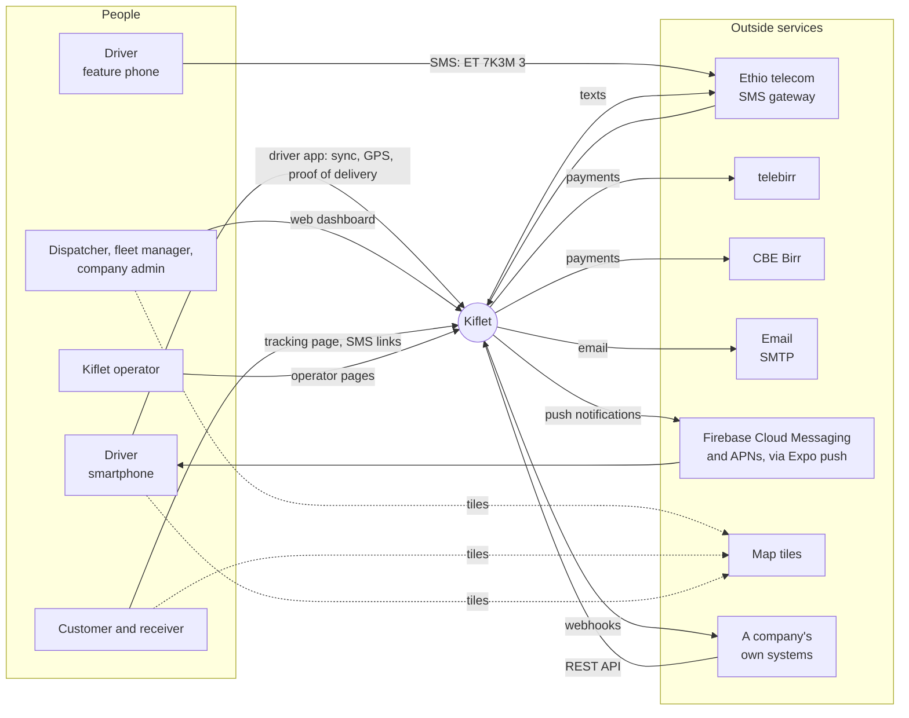

---

## 3. The deployable parts

Each box is a container image. Everything except the clients and the
outside services runs on the company's VMs with Docker Compose (section 13).

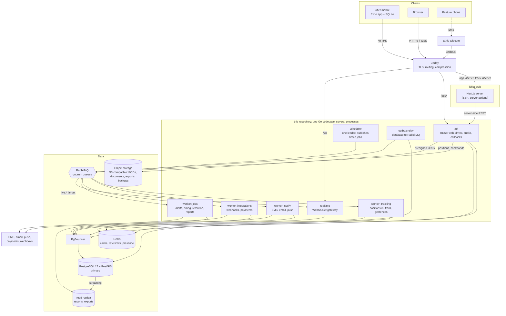

| Part | Repository | Language | Scales by | State |
|---|---|---|---|---|
| Caddy | this one (`deployments/`) | config | 1–2 instances behind DNS | none |
| Next.js server | kiflet-web | TypeScript | replicas | none |
| `api` | this one, `cmd/api` | Go | replicas | none (Postgres, Redis) |
| `realtime` | this one, `cmd/realtime` | Go | replicas | connections only |
| `worker` | this one, `cmd/worker --queues=…` | Go | replicas per queue group | none |
| `scheduler` | this one, `cmd/scheduler` | Go | 2 instances, one leads (advisory lock) | none |
| `relay` | this one, `cmd/relay` | Go | 2 instances, one leads | none |
| PostgreSQL + PostGIS | image | | primary + replica; vertical first | source of truth |
| PgBouncer | image | | 1 per database VM | none |
| RabbitMQ | image | | 3-node cluster | durable queues |
| Redis | image | | 1 primary + replica with Sentinel | can be lost |
| Object storage | SeaweedFS or MinIO on VMs, or a hosted S3 | | volumes | files |
| Driver app | kiflet-mobile | TypeScript | phones | SQLite on the phone |

All the Go processes are the same binary with different commands, built
from one codebase. They share modules, but each process only starts what it
needs. This keeps the business rules in one place while letting the parts
under load (positions, notifications) scale on their own.

---

## 4. The backend's modules

The backend is split into modules by business area. A module owns its
tables, its rules and its HTTP handlers. Other modules reach it only
through its Go interface (synchronous) or its events (asynchronous), never
by querying its tables.

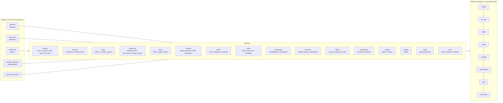

### How modules depend on each other

The arrows point the way calls go. There are no cycles: a module lower down
never calls one higher up; it publishes an event instead.

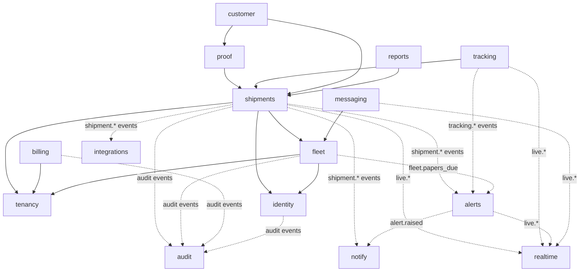

### What each module owns

| Module | Owns (tables) | Publishes | Consumes |
|---|---|---|---|
| identity | `users`, `sessions`, `verification_codes`, `email_tokens`, `pending_signups` | `user.created`, `user.disabled` | |
| tenancy | `tenants`, `saved_filters` | `tenant.created`, `tenant.suspended`, `tenant.deleted` | `billing.standing_changed` |
| fleet | `vehicles`, fleet papers, driver profile fields | `fleet.papers_due` | `tracking.driver_seen` |
| shipments | `shipments`, `shipment_events` (append-only), `shipment_documents`, `shipment_charges` | `shipment.booked`, `.assigned`, `.status_changed`, `.delivered`, `.cancelled` | `proof.recorded`, `sms.status_reported` |
| proof | `proof_of_deliveries` | `proof.recorded`, `proof.reviewed` | |
| tracking | `tracking_events` (partitioned), `driver_positions`, `sync_metadata` | `tracking.position_stored`, `.stop_started`, `.off_route`, `.arrived_near`, `.driver_seen` | `tracking.positions` (commands) |
| alerts | `alerts`, `alert_rules` | `alert.raised`, `alert.resolved` | shipment, tracking and fleet events; `jobs.alerts.*` |
| notify | `sms_messages`, `sms_opt_outs`, `emails`, push tokens | `sms.status_reported`, `sms.inbound` | `notify.sms`, `notify.email`, `notify.push` |
| messaging | `broadcasts`, `broadcast_recipients`; messages between a driver and the office are shipment events (`shipment_events`), written through shipments | `message.sent` | |
| customer | confirmation links | `customer.confirmed` | |
| billing | `invoices`, `invoice_counters`, `payments`, `billing_notices` | `billing.invoice_issued`, `.paid`, `.standing_changed` | `jobs.billing.*` |
| integrations | `api_keys`, `webhook_endpoints`, `webhook_deliveries` | | shipment events (delivered as webhooks) |
| reports | read models (materialised views) | | `jobs.reports.refresh` |
| support | `support_tickets`, `support_messages` | `support.message` | |
| audit | `audit_logs` (append-only) | | `audit.*` |
| data | | | `jobs.retention`, `data.export_requested` |

### Inside a module

Every module has the same layout, so anyone can find their way around any
of them:

```
internal/modules/shipments/
  shipments.go       the module's Go interface: what other modules may call
  domain/            types and rules, no I/O (statuses, transitions, validation)
  app/               use cases: Book, Assign, ChangeStatus... (transactions, events)
  store/             sqlc queries for its own tables (queries/*.sql → generated)
  http/              handlers for /api/web, /api/driver, /api/v1 routes it serves
  events/            event types it publishes, with versions; consumers it runs
  shipments_test.go  module tests against a real Postgres
```

Rules that hold in every module:

- **Tenant first.** Every query takes the tenant ID, and every table has
  `tenant_id`. A test runs each query with another tenant's ID and expects
  nothing back.
- **One transaction, one outbox write.** A use case that changes data and
  must tell others writes its event to `outbox` in the same transaction
  (section 6). No event is lost and none is sent for a change that was
  rolled back.
- **Handlers stay thin.** They parse, call one use case and render JSON.
  The rules are in `app/` and `domain/`.
- **Status rules stay in one place.** `model.AllowedTransitions` becomes
  `shipments/domain`, and the driver app and the web read it from the API
  (`/api/driver/config`), never from their own copy.

---

## 5. Data

### PostgreSQL is the source of truth

One PostgreSQL 17 cluster with PostGIS. Each module's tables move into
their own **schema** (`shipments.shipments`, `tracking.tracking_events`…)
so ownership shows in the database too, and a module could later move to
its own database without untangling joins.

- **Connections:** through PgBouncer in transaction mode. At 20,000 drivers
  the API and workers together need about 200 server connections, which a
  single primary handles.
- **Read replica:** reports, CSV and PDF exports, and the company data
  export read from a streaming replica, so a large report never slows
  dispatch.
- **Append-only tables:** `shipment_events` and `audit_logs` keep their
  triggers that reject UPDATE, DELETE and TRUNCATE. Purges run in
  `purgeTx`, as today.
- **Migrations:** goose, run by `cmd/migrate` as a one-off container before
  a deploy, not at API start (several replicas must not race). Each
  migration is rerunnable and backwards-compatible with the version
  running, so deploys need no downtime ("expand, then contract").

### GPS positions

`tracking_events` is the only table that grows fast: about 6 million rows
on a busy day at 20,000 drivers (section 15).

- **Partitioned by day** (native declarative partitions). The scheduler
  creates tomorrow's partition ahead of time. Retention drops whole
  partitions older than 90 days instead of deleting rows, which is instant
  and leaves no bloat.
- **Indexes per partition:** `(shipment_id, recorded_at)`,
  `(tenant_id, driver_id, recorded_at DESC)`, and BRIN on `recorded_at`.
  The GiST index on `coordinates` moves to `driver_positions` and the
  geofence tables, which are small.
- **Written in batches:** the tracking worker writes with `COPY` or
  multi-row `INSERT … ON CONFLICT (device_id, client_id) DO NOTHING`, a few
  hundred positions per statement.
- **Simplified after delivery:** 30 days after delivery a job keeps one
  position every 5 minutes plus every stop and turn (Douglas–Peucker), so
  the trail still draws but takes a fifth of the space.

### Object storage

Signatures, photos, shipment documents, data exports and database backups
live in S3-compatible storage (SeaweedFS or MinIO on the VMs, as staging
does now, or a hosted S3). The API hands out **presigned URLs**: phones
upload photos straight to storage and the API never carries the bytes.
Every object key starts with the tenant ID.

### Redis holds nothing that can't be rebuilt

Section 7. If Redis is emptied, everything still works, only slower until
the cache fills again.

---

## 6. RabbitMQ

### Why a broker, and what for

Postgres can store 350 positions a second. The broker is there for what
happens around the positions:

- **Bursts:** a few thousand phones reconnecting at once send hours of
  positions in a minute. The API accepts them into a durable queue and
  answers at once. Workers drain the queue at a steady rate.
- **Isolation:** a slow SMS gateway or a company's broken webhook endpoint
  backs up its own queue. The API and the dashboard don't notice.
- **Fan-out:** one "shipment delivered" event reaches alerts, notify,
  webhooks, live updates and audit, each with its own retries.
- **Scaling by work type:** more tracking workers when positions pile up,
  without adding API replicas.

### Topology

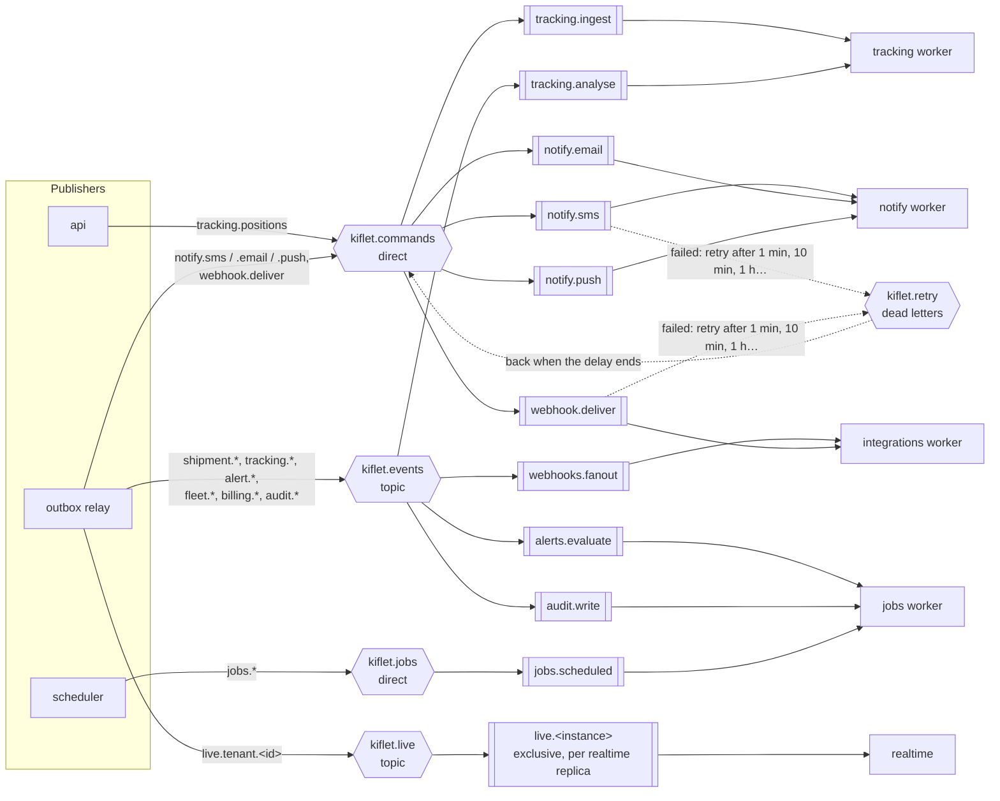

| Queue | Kind | Consumers | Prefetch | On failure |
|---|---|---|---|---|
| `tracking.ingest` | quorum | tracking worker, 2–6 | 500 (batches) | 5 retries, then `tracking.ingest.dead` with an alert to the operator |
| `tracking.analyse` | quorum | tracking worker | 100 | retry; the next position re-evaluates anyway |
| `alerts.evaluate` | quorum | jobs worker | 50 | retry ×5, dead letter |
| `notify.sms` | quorum | notify worker | 20 (gateway rate) | delayed retries over 24 h, then marked failed in `sms_messages` |
| `notify.email` | quorum | notify worker | 20 | delayed retries over 24 h |
| `notify.push` | quorum | notify worker | 100 | 3 retries; an invalid token is deleted |
| `webhook.deliver` | quorum, one per delivery | integrations worker | 20 | Standard Webhooks schedule over 24 h, as today |
| `webhooks.fanout` | quorum | integrations worker | 50 | retry; creates `webhook_deliveries` rows |
| `audit.write` | quorum | jobs worker | 200 | retry; never dropped |
| `jobs.scheduled` | quorum | jobs worker | 1 | the next tick runs it again |
| `live.<instance>` | classic, exclusive, auto-delete, TTL 10 s | its realtime replica | 500 | dropped: live updates are best-effort, pages refetch |

### Rules every message follows

- **Envelope:** each message carries `id` (UUID), `type` (for example
  `shipment.status_changed`), `version`, `tenant_id`, `occurred_at`,
  `trace_id` and `payload`. Consumers ignore versions they don't know and
  keep accepting the previous version for one release after a change.
- **At least once:** publishers use publisher confirms; consumers ack after
  their transaction commits. So any message may arrive twice, and every
  consumer is idempotent: it records the message ID (`processed_messages`,
  kept 7 days) or relies on a unique key (`client_id` for positions,
  `delivery_id` for webhooks).
- **Order:** only per shipment where it matters. Status events carry the
  shipment's event sequence number; a consumer that sees an older one than
  it has applied skips it.
- **The outbox:** a use case writes its events to an `outbox` table in the
  same transaction as the change. The relay reads new rows (`SELECT … FOR
  UPDATE SKIP LOCKED`, woken by `LISTEN`), publishes with confirms, then
  marks them sent. If RabbitMQ is down, events wait in Postgres and nothing
  is lost.
- **The exception is positions:** the API publishes them straight to
  `tracking.ingest` with a confirm before it answers the phone, because
  writing them to Postgres first would defeat the point of the queue. The
  phone keeps a position in its SQLite until the API confirms it, so a
  failed publish just means the phone sends it again.

---

## 7. Redis

Redis speeds things up and coordinates replicas. It is never the only copy
of anything.

| Use | Keys | TTL | If Redis is gone |
|---|---|---|---|
| Session lookup | `sess:<token-hash>` → user, tenant, role, expiry | 5 min, refreshed | Read `sessions` from Postgres |
| Driver tokens | `dtok:<token-hash>` | 5 min | Postgres |
| API keys | `key:<hash>` → tenant, scopes | 5 min | Postgres |
| Rate limits | `rl:<route>:<ip or user>` sliding window (Lua) | window | Fall back to per-instance memory limits, with lower limits |
| Latest driver positions | `pos:<tenant>` hash of driver → lat, lng, at, speed, battery | 7 days | Read `driver_positions` |
| Presence | `online:<tenant>` sorted set, driver → last seen | 15 min | Use `sync_metadata.last_sync_at` |
| Tenant data | `tenant:<id>` settings, plan, limits, standing | 10 min, deleted on change | Postgres |
| Sync idempotency | `sync:<device>:<request-id>` → stored response | 10 min | Each item is idempotent by `client_id` anyway |
| Fleet map payload | `fleetmap:<tenant>` | 15 s | Built from Postgres |
| One-time codes, attempt counts | `otp:<phone>` | 10 min | Postgres (`verification_codes`) |
| Leader lock (backup) | `lock:scheduler` | 30 s | The Postgres advisory lock is the real one |

Cache entries are removed when their source changes: the module that
changes a tenant's settings deletes `tenant:<id>` after the commit (and
publishes `tenant.changed`, which other replicas use to clear their own
memory caches).

Redis runs with AOF persistence so a restart doesn't empty it, and with a
replica and Sentinel so a VM failure doesn't take it down. With one VM's
worth of data (a few GB at 20,000 drivers), one primary is enough.

---

## 8. The main flows

### A driver syncs (positions, statuses, a delivery)

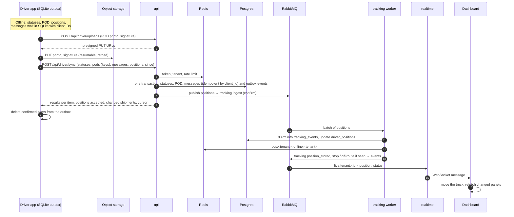

The sync stays one request with many items, as today: one round trip on a
weak connection is worth more than tidy endpoints. Each item succeeds or
fails on its own, and the response says which.

### A dispatcher books a load

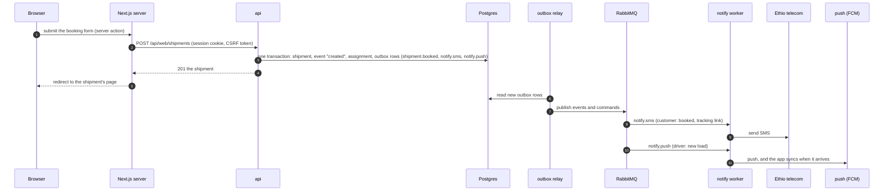

### A feature-phone driver reports by SMS

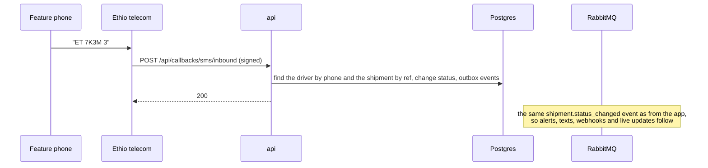

### Live updates reach every open dashboard

Each realtime replica binds its own exclusive queue to `kiflet.live` with
the routing keys of the tenants whose dashboards are connected to it. A
message names what changed (`shipment`, `alerts`, `position`) and the IDs;
the page refetches the parts it shows. Live messages carry no data a user
of that tenant couldn't read anyway, and are dropped rather than queued for
long, because the page catches up on its next fetch.

---

## 9. The driver app (kiflet-mobile)

React Native with Expo, TypeScript, Android first (most drivers), iOS from
the same code.

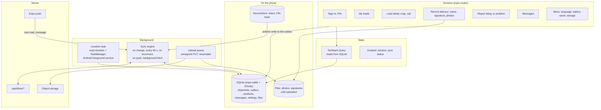

### Offline first

- **The screen reads only SQLite.** Nothing waits on the network. A
  driver's action (depart, arrive, deliver, report) writes the new state
  and an outbox row in one SQLite transaction and shows at once.
- **The outbox** holds every change with a `client_id` (UUID), its type,
  its payload and how many times it was tried. The sync engine sends
  everything waiting, oldest first, and deletes an item only when the
  server confirms it. Duplicates are harmless because the server is
  idempotent by `client_id`.
- **Positions** go into their own table and are sent in batches of up to
  500, compressed (gzip). A phone that has been out of signal for a day
  sends them over several syncs.
- **Conflicts:** the server is the judge. When the office changed a load
  while the phone was offline, the sync result says so and the app takes
  the server's version, telling the driver what changed (as the PWA does
  now, `docs/E2E_TEST_GUIDE.md` section 5).
- **Space:** delivered loads are deleted after 7 days; photos after they're
  uploaded and confirmed. The menu shows what the app holds.
- **Schema changes:** Drizzle migrations run when the app starts. A sync
  from an app older than the server supports gets `426 Upgrade Required`,
  and the app says to update.

### GPS that keeps going

- `expo-location` background updates through `TaskManager`, as an Android
  **foreground service** with a permanent notification ("Kiflet is
  recording your trip"), so Android doesn't kill it with the screen off.
- One position a minute while moving, every 5 minutes when slow, none
  after 10 minutes parked (as today, `static/driver/gps.js`). Battery
  saver: every 15 minutes, coarse accuracy.
- The location task only writes to SQLite; the sync engine sends. A
  position is kept even if the app is killed before the next sync.
- Tracking runs only while the driver has an active load and location
  sharing is on, and stops when the last load is delivered.

### Updates

- **Expo Updates (EAS Update)** for JavaScript changes: phones get them at
  the next start, without the Play Store. Native changes (new permissions,
  SDK upgrades) need a store release.
- Distributed through Google Play, with a signed APK on the website for
  phones without Play.

---

## 10. The web app (kiflet-web)

Next.js with the App Router, TypeScript, React Server Components.

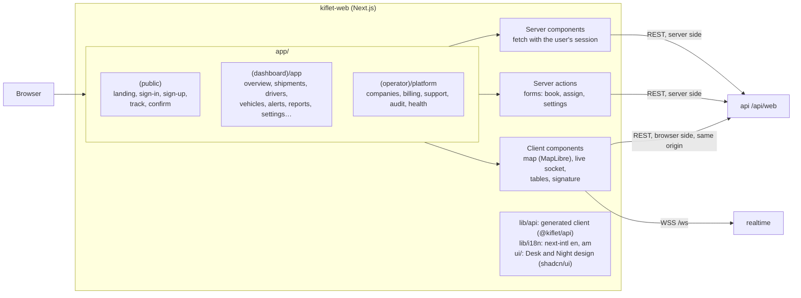

- **One origin.** Caddy serves Next.js at `app.kiflet.et` and sends
  `/api/*` and `/ws` on the same host to the Go services. The session
  cookie is `HttpOnly`, `Secure`, `SameSite=Lax`, set by the Go API, and
  works for both, so there is no token in the browser's JavaScript and no
  CORS.
- **Rendering:** pages render on the server with the user's session
  (server components call the API with the cookie forwarded). Interactive
  parts (map, live updates, filters, the signature pad) are client
  components.
- **The design:** the Desk (light) and Night (dark) tokens from today's
  `static/app.css` become Tailwind theme tokens and shadcn/ui components;
  Desk is already shadcn/ui's new-york style. Fonts (Geist) and lucide
  icons come over as they are.
- **Text:** next-intl with `en` and `am` message files. Public pages and
  everything a customer reads are in both languages from the first
  release, as now; the dashboard's Amharic waits for review (W1).
- **Maps:** MapLibre GL with the same OpenStreetMap tiles, the trails and
  gaps drawn as on today's maps.
- **Public pages are small:** tracking and confirmation pages are rendered
  on the server with almost no JavaScript, because customers open them on
  cheap phones over mobile data.
- **Security headers:** a strict CSP with nonces (Next.js middleware), as
  strict as today's `script-src 'self'`.

---

## 11. APIs and contracts

| API | Path | Who | Auth | Contract |
|---|---|---|---|---|
| Web | `/api/web/*` | kiflet-web (server and browser) | session cookie + CSRF header | `api/openapi/web.yaml` |
| Driver | `/api/driver/*` | kiflet-mobile | bearer token from PIN sign-in, per device | `api/openapi/driver.yaml` |
| Public | `/api/v1/*` | companies' own systems | API key | `api/openapi/v1.yaml` (today's `openapi.json`) |
| Callbacks | `/api/callbacks/*` | Ethio telecom, telebirr, CBE Birr | provider signatures | per provider |
| Live | `/ws` | kiflet-web | session cookie | `api/asyncapi/live.yaml` |
| Webhooks | out | companies' systems | Standard Webhooks signature | `api/asyncapi/webhooks.yaml` |

- **The OpenAPI files in this repository are the contract.** CI checks that
  the Go handlers match them (as `TestOpenAPIMatchesTheAPI` does today for
  the public API) and generates a TypeScript client, published as the
  `@kiflet/api` package to GitHub Packages. kiflet-web and kiflet-mobile
  depend on a version of it, so a breaking change shows up as a type error
  there, not at run time.
- **Versioning:** `/api/web` changes with kiflet-web, deployed together;
  `/api/driver` must keep serving app versions still on phones (at least
  the last two releases, or 90 days); `/api/v1` follows today's rules:
  additions only.
- **Errors** are one shape everywhere: `{ "error": { "code", "message",
  "fields" } }`, codes stable, messages translatable.

---

## 12. Security

- **Tenant isolation:** every query is scoped by tenant (as today), and
  Postgres row-level security on the module schemas is added as a second
  wall: each request's transaction sets `app.tenant_id`, and policies check
  it.
- **Staff:** email or phone and password, sessions in Postgres (cached in
  Redis), optional 2FA codes. Roles: dispatcher, fleet manager, admin,
  operator, as today.
- **Drivers:** phone and PIN, one token per device, revocable from the
  dashboard; the token lives in the phone's SecureStore.
- **API keys** hashed, scoped, revocable; **webhooks** signed.
- **Rate limits** shared across replicas in Redis, per IP and per account,
  strict on sign-in, codes and tracking look-ups.
- **Files:** presigned URLs valid for minutes, keys prefixed by tenant, file
  types checked by content after upload (as `shipment_files.go` does now).
- **Secrets** in files mounted into containers (`*_FILE` variables, as
  today), never in images or the repository; gitleaks in CI.
- **Audit:** every change a person makes is in `audit_logs`, which can't be
  edited.

---

## 13. Deployment

VMs with Docker Compose. Each VM runs a compose file from this repository's
`deployments/`, with its part of the system. At 20,000 drivers:

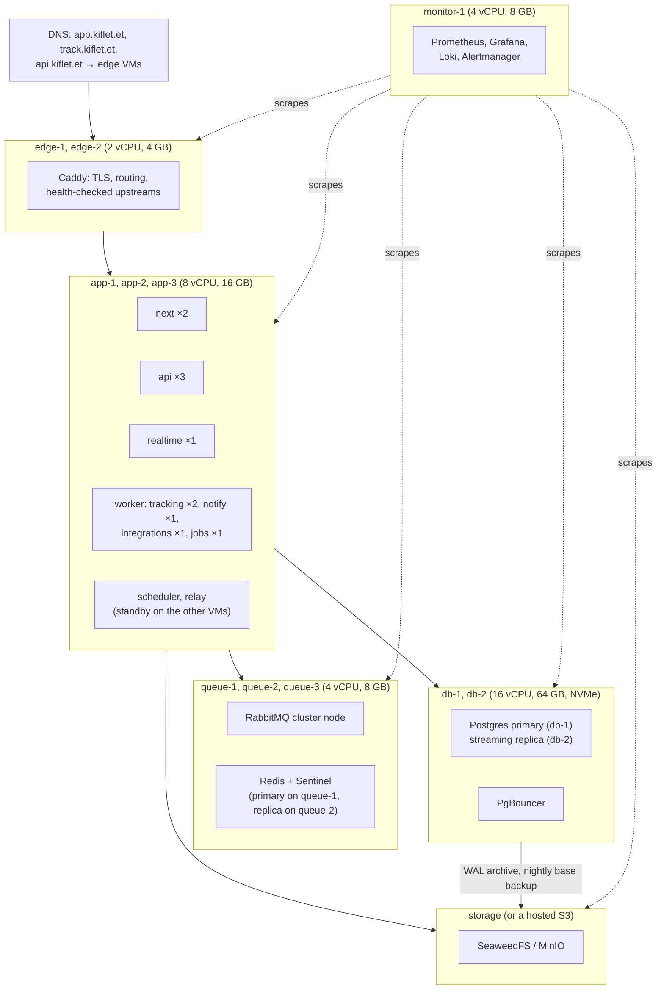

- **Private network** between the VMs; only the edge VMs take traffic from
  the internet. Postgres, Redis and RabbitMQ listen only on the private
  network.
- **Deploys:** CI builds images tagged with the commit; a deploy runs
  `migrate`, then replaces API and worker containers one VM at a time
  (Caddy's health checks take a VM out while it restarts). Next.js deploys
  the same way from kiflet-web's CI.
- **Backups:** continuous WAL archiving and nightly base backups to object
  storage with point-in-time restore (pgBackRest or WAL-G), a restore
  tested in CI as `tests/e2e`'s last test does today. RabbitMQ definitions
  exported nightly; Redis needs none.
- **Staging** is the same compose files with stand-ins for the outside
  world (the provider sandbox, Mailpit, SeaweedFS, Caddy's own CA), on one
  VM, as `deployments/staging` is now.
- **Smaller to start:** below 2,000 drivers everything fits on three VMs
  (edge+app, queue+db, monitor) with the same compose files; parts move to
  their own VMs as load grows, with no code change.

---

## 14. Observability

- **Metrics** (Prometheus, `pkg/metrics` rules kept: labels by route or
  queue, never by tenant, user or shipment): request rate, latency and
  errors per route; queue depth, age of the oldest message and consumer
  rate per queue; positions per second in and stored; sync failures by
  reason; outbox lag; SMS sent and failed; Postgres and PgBouncer pools;
  Redis hit rate.
- **Logs:** JSON (zerolog), to Loki, with `request_id` and `trace_id`.
- **Traces:** OpenTelemetry from Next.js through the API, RabbitMQ
  (headers in the envelope) and workers.
- **Alerts** (Alertmanager to the operator by SMS and email): oldest
  message in `tracking.ingest` over 2 minutes; any dead-lettered message;
  outbox lag over 1 minute; 5xx over 1%; replica lag over 30 s; disk over
  80%; backup older than 26 hours; certificate expiring within 14 days.
- **Health pages:** the operator's System health page reads the same
  figures.

---

## 15. Capacity at 20,000 drivers

The figures the sizing in section 13 comes from. "Peak" assumes 60% of
drivers on the road at once.

| Figure | Estimate |
|---|---|
| Drivers on the road at peak | 12,000 |
| Positions a second, steady | 12,000 ÷ 60 s = **200/s** (one a minute while moving; less when slow or parked) |
| Positions a second, burst | 3,000 phones reconnecting with 2 hours each (120 positions) inside 5 minutes = **1,200/s** for 5 minutes, absorbed by the queue |
| Sync requests a second | 12,000 phones every 60 s = **200/s**; each small (gzip) |
| Positions a day | ~6 million (10 hours of driving each) |
| `tracking_events` size | ~150 bytes a row with indexes → ~0.9 GB a day, **~80 GB** over 90 days before simplification, ~25 GB after |
| Dashboard users online | ~2,000 dispatchers, one WebSocket each |
| Live messages | positions coalesced per tenant to one message every 5 s: under 1,000/s across all sockets |
| SMS | ~10 texts per shipment; 10,000 shipments a day → **100,000 texts a day**, ~5/s at peak, limited by the gateway |
| Photos | 2 per delivery at ~300 KB → ~6 GB a day into object storage |

What each part handles at that load, with room to spare:

- **api ×3:** 200 sync/s plus ~500 web requests/s; Go handles several
  thousand simple requests a second per core, so CPU is not the limit;
  Postgres connections are, which is why PgBouncer.
- **tracking workers ×2:** batches of 500 positions with `COPY` store
  10,000+ positions a second each, so a 1,200/s burst drains as fast as it
  comes.
- **RabbitMQ (3 nodes):** a few thousand messages a second is light work
  for quorum queues on modest VMs.
- **Postgres:** ~400 writes a second in batches and indexed reads; the
  primary's NVMe and 64 GB keep the working set (today's partitions and the
  hot tables) in memory.

When to grow: more `api` and worker replicas first (no code change); then
a bigger database VM; then, past ~50,000 drivers, positions could move to
their own database (TimescaleDB or a separate Postgres), which the
module boundary already allows.

---

## 16. What is deliberately not in it

- **Microservices now.** Separate services per module would mean separate
  deploys, network calls between modules and distributed transactions, for
  a team this size. The module boundaries and the broker make the split
  possible later for the module that needs it (most likely tracking).
- **Kubernetes.** Docker Compose on VMs, as chosen. The images and health
  checks are the same, so moving later means writing manifests, not
  changing code.
- **A separate database per module, Kafka, event sourcing.** Not needed at
  this scale: Postgres with schemas, RabbitMQ and the outbox do the job
  with fewer moving parts.
- **Redis as a source of truth or as a queue.** RabbitMQ queues work;
  Redis caches.
- **GraphQL.** REST with generated types covers both clients; the driver
  sync is a single purpose-built endpoint.
